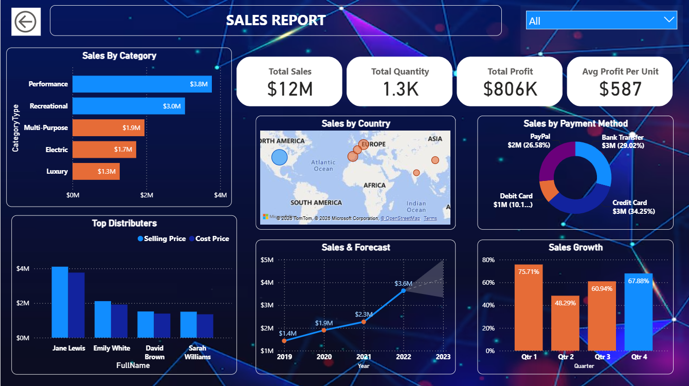
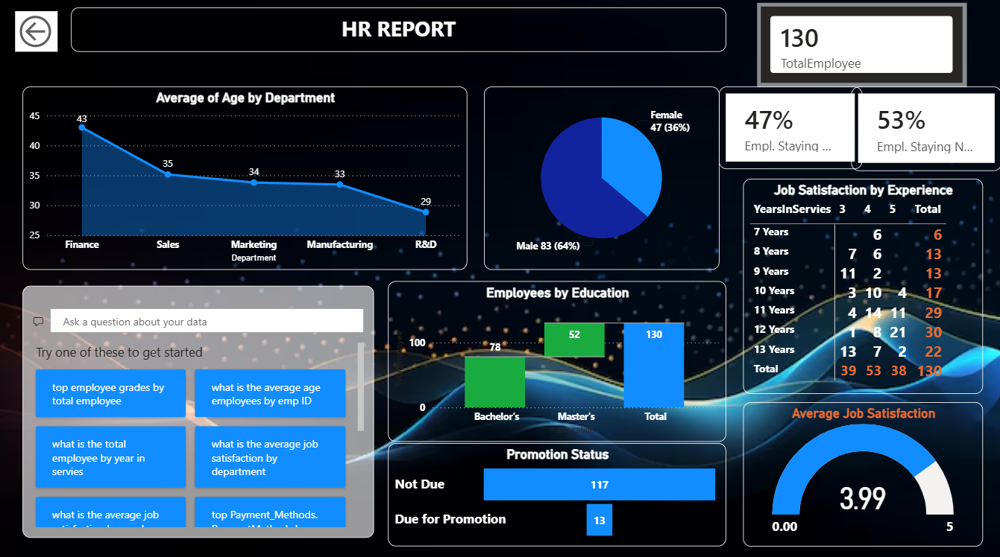
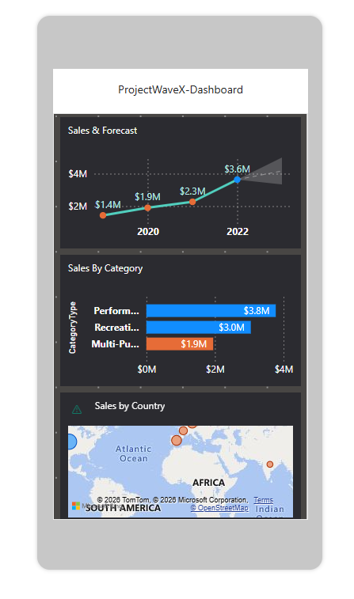

# 📊 WaveX – Data Sales & HR Analytics Dashboard

### 🚀 Turning Business Data into Meaningful Insights!

## 📌 Project Overview

WaveX is an interactive Microsoft Power BI dashboard project developed to analyse Sales and HR data. It transforms raw data into meaningful insights through interactive visualizations, charts, and KPIs, helping users understand business performance and workforce trends.

## 🛠️ Tools & Technologies

* 📊 Microsoft Power BI
* 🔄 Power Query
* 📐 DAX (Data Analysis Expressions)
* 📈 Data Visualization

## ✨ Key Features

* 💰 Sales Performance Analysis
* 👥 HR Analytics and Employee Insights
* 📊 Interactive Charts and Visualizations
* 🎯 Key Performance Indicators (KPIs)
* 🔍 Dynamic Filters and Slicers
* 📱 Mobile and Desktop Dashboard Views

## 🖥️ Desktop Dashboard

### 💼 Sales Dashboard

### 👨‍💼 HR Dashboard

## 📱 Mobile Dashboard

Experience the dashboard with a mobile-friendly layout.

## 📂 Project Files

* 📁 `WaveX-PowerBI1.pbix` – Complete Power BI project file.
* 🖼️ Dashboard screenshots – Desktop and Mobile views.

📥 Download the `.pbix` file and open it using Microsoft Power BI Desktop to explore the complete dashboard.

## 👨‍💻 Author

**Rohan B Gowda**

⭐ If you find this project interesting, feel free to explore the repository!
